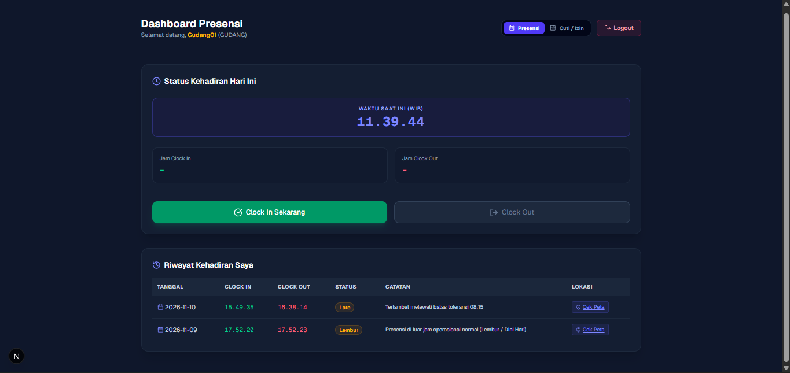
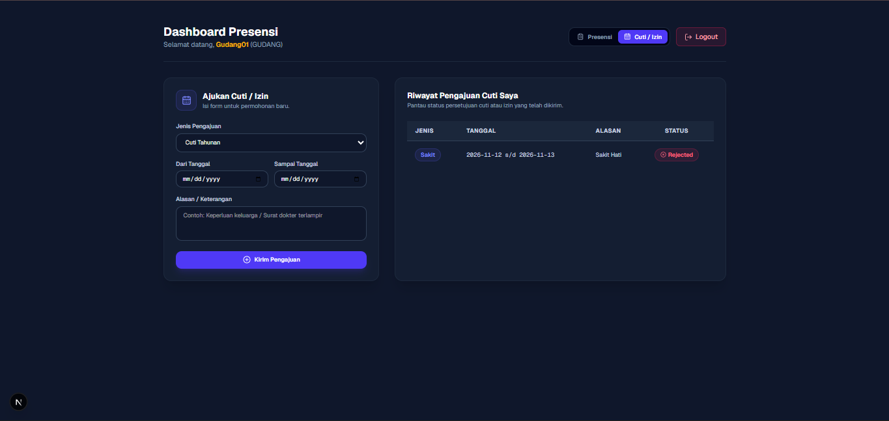
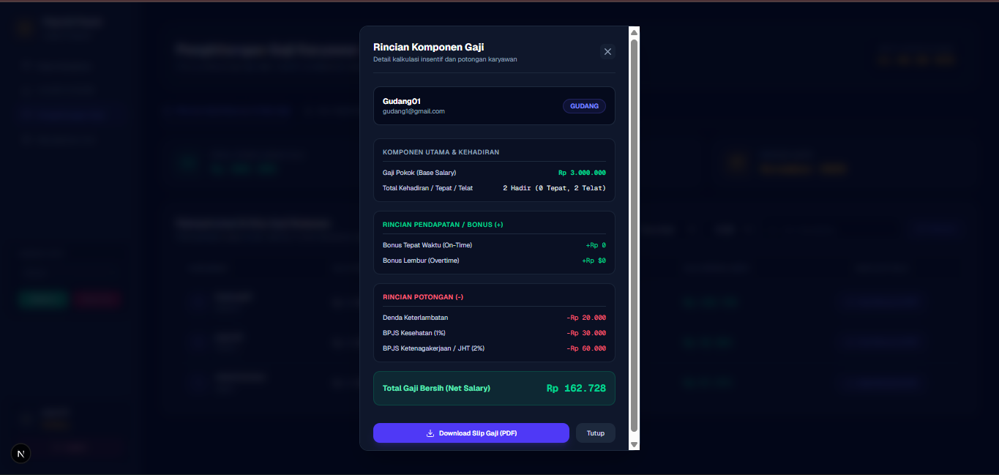
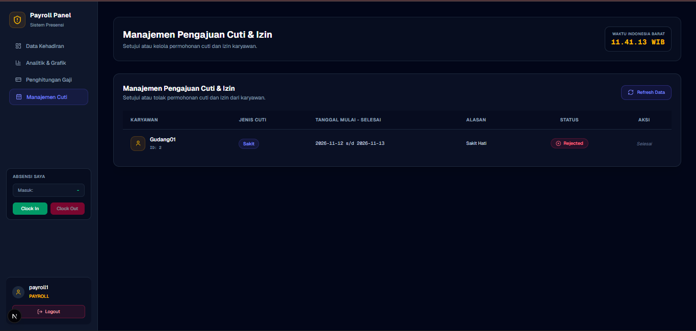

# 🏢 DPA-Attend: Employee Attendance, Leave Management & Payroll System

<p align="center">
  
  
  
  
</p>

Aplikasi manajemen kehadiran (*attendance*), pengajuan cuti mandiri (*self-service leave*), dan rekapitulasi gaji otomatis (*automated payroll*) berbasis web dengan arsitektur *full-stack*. Dibangun untuk mencakup logika bisnis dunia nyata secara *end-to-end*, mulai dari validasi geolokasi GPS hingga sinkronisasi otomatis status cuti terhadap potongan gaji.

---

## 🚀 Tech Stack

### Frontend
* **Framework:** Next.js (App Router)
* **Styling:** Tailwind CSS
* **Icons:** Lucide React
* **State & Networking:** Fetch API, React Hooks

### Backend
* **Framework:** FastAPI (Python)
* **ORM:** SQLAlchemy
* **Database:** PostgreSQL
* **Utilities:** Datetime / Timezone management (WIB)

---

## ✨ Key Features

1. **Real-Time Attendance & Geolocation**
   * Fitur *Clock In* dan *Clock Out* harian dilengkapi validasi waktu otomatis (zona waktu WIB) serta tangkapan titik koordinat GPS (*Latitude & Longitude*) yang terintegrasi langsung dengan Google Maps.
2. **Employee Leave & Permission Management**
   * Karyawan dapat mengajukan cuti tahunan, sakit, atau izin secara mandiri melalui *dashboard* dengan memilih rentang tanggal dan alasan.
   * Panel *approval* khusus Admin/Payroll untuk menyetujui (*Approved*) atau menolak (*Rejected*) pengajuan cuti secara *real-time*.
3. **Automated Payroll Engine**
   * Kalkulasi slip gaji bulanan otomatis yang transparan mencakup: Gaji Pokok, Bonus Tepat Waktu, Bonus Lembur (*Overtime*), Potongan Keterlambatan, hingga iuran BPJS (Kesehatan & JHT).
   * **Smart Leave Integration:** Hari-hari cuti yang berstatus *Approved* secara otomatis mengecualikan karyawan dari potongan alfa/ketidakhadiran secara adil.
4. **Multi-Role Access Control**
   * Hak akses berbasis peran terpisah antara **Karyawan** (Dashboard mandiri) dan **Admin/Payroll** (Manajemen data & rekapitulasi gaji).

---

## 📸 Tampilan Aplikasi

### 1. Dashboard Presensi Utama
Antarmuka utama karyawan yang menyajikan informasi status kehadiran harian secara *real-time* dengan sinkronisasi zona waktu WIB. Dilengkapi tombol aksi cepat untuk *Clock In* / *Clock Out* serta tabel riwayat absensi komprehensif yang memuat indikator status kerja seperti keterlambatan (*Late*), lembur (*Overtime*), dan tautan validasi titik koordinat GPS (*Cek Peta*).


### 2. Form Pengajuan Cuti & Izin Karyawan
Modul layanan mandiri (*Self-Service*) bagi karyawan untuk mengajukan permohonan cuti tahunan, sakit, atau izin secara digital. Dilengkapi formulir pemilihan rentang tanggal dan keterangan alasan, serta tabel pantauan status pengajuan secara transparan (*Pending*, *Approved*, atau *Rejected*).


### 3. Rincian Komponen Gaji (Payroll Modal)
Fitur kalkulasi gaji otomatis dan transparan yang merinci komponen finansial karyawan secara akurat. Mencakup akumulasi gaji pokok berdasarkan total kehadiran, bonus tepat waktu dan lembur, potongan denda keterlambatan dan iuran BPJS, perhitungan total gaji bersih (*Net Salary*), serta fitur unduh slip gaji berformat PDF.


### 4. Manajemen Pengajuan Cuti Admin (Payroll Panel)
Panel kendali terpusat khusus *admin* dan tim *payroll* untuk mengawasi, menyetujui, atau menolak permohonan cuti dan izin dari seluruh karyawan secara *real-time* guna memastikan integritas data absensi sebelum kalkulasi penggajian diproses.


---

## 📂 Project Structure

```text
absensi-app/
│
├── backend/                  # FastAPI Backend Server
│   ├── app/
│   │   ├── routers/          # Endpoint API (attendance, payroll, leaves, dll)
│   │   ├── models.py         # SQLAlchemy Database Models
│   │   └── database.py       # DB Connection Setup
│   └── requirements.txt      # Python Dependencies
│
├── frontend/                 # Next.js Frontend Application
│   ├── src/app/              # App Router Pages (dashboard, admin, login)
│   └── package.json          # Node Dependencies
│
├── screenshots/              # Application UI Previews
│
├── docker-compose.yml        # Docker orchestration config
└── .gitignore

```
---

## 🛠️ Getting Started Locally

Ikuti langkah-langkah di bawah ini untuk menjalankan proyek secara lokal di perangkatmu:

### 1. Clone Repository

git clone [https://github.com/DanarPA/absensi-app.git](https://github.com/DanarPA/absensi-app.git)
cd absensi-app

### 2. Jalankan Backend (FastAPI)
cd backend
python -m venv venv
Aktifkan virtual environment:
Windows (cmd/powershell): .\venv\Scripts\activate
Mac/Linux: source venv/bin/activate

pip install -r requirements.txt
uvicorn app.main:app --reload

Backend akan berjalan di http://127.0.0.1:8000

### 3. Jalankan Frontend (Next.js)
cd frontend
npm install
npm run dev

## 🛡️ Security & Best Practices
### 1. Menerapkan file .gitignore yang ketat untuk mencegah kebocoran kredensial sensitif (.env, direktori node_modules/, venv/, dan file cache lokal).

### 2. Pemisahan tanggung jawab (separation of concerns) yang jelas antara logika client-side dan server-side REST API.

## 👤 Author
Danar Putera Andika
### GitHub: @DanarPA